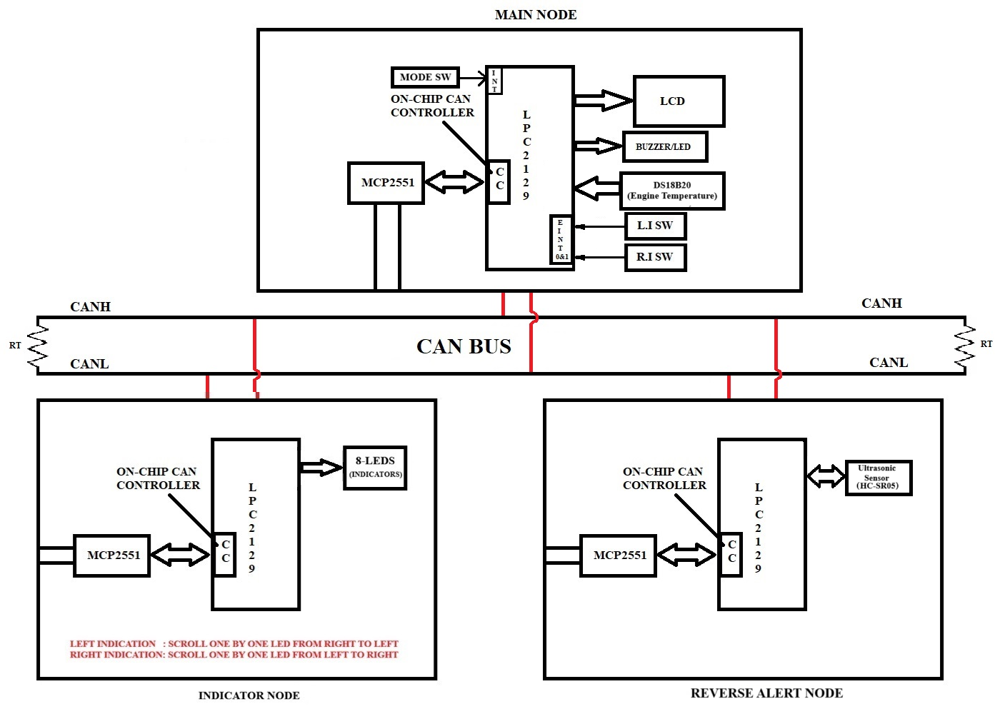
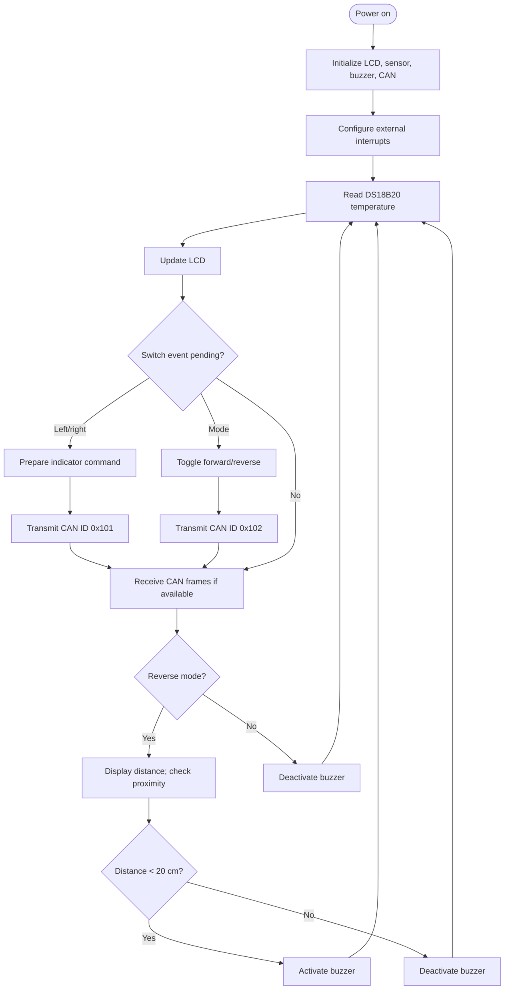
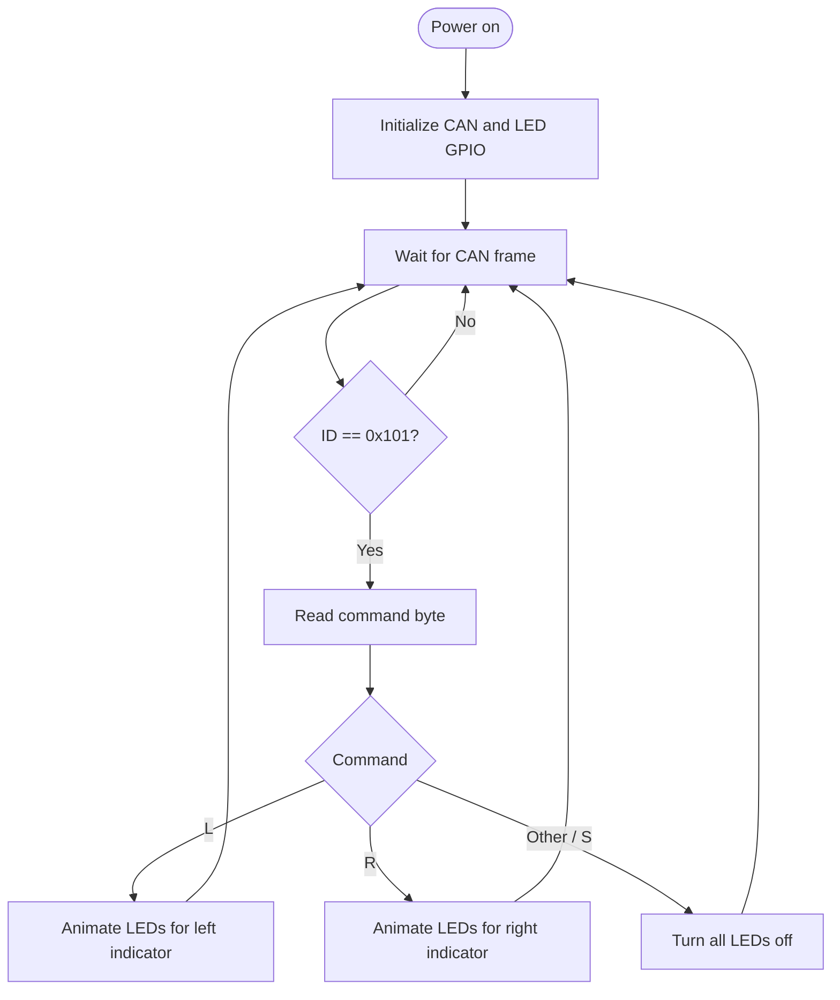
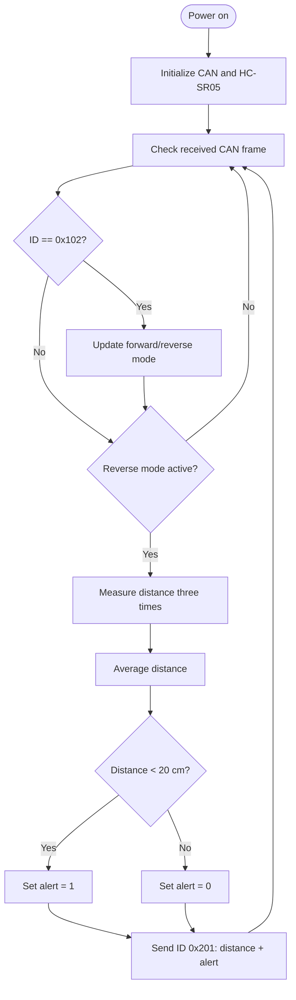

# Multi-Node CAN-Based Vehicle Monitoring and Reverse Safety System


> A three-node embedded vehicle-monitoring prototype using CAN communication to monitor engine temperature, control left/right indicators, and provide an ultrasonic reverse-obstacle warning.

**Important:** This repository is organized from the supplied project document and source archive. The source files have not been verified on physical hardware in this environment. Treat the code as a project snapshot and complete the build, pin checks, and hardware tests described below before relying on it.

## Table of contents

- [Overview](#overview)
- [Project aim and objectives](#project-aim-and-objectives)
- [System architecture](#system-architecture)
- [Node responsibilities](#node-responsibilities)
- [CAN message protocol](#can-message-protocol)
- [Hardware requirements](#hardware-requirements)
- [Software requirements](#software-requirements)
- [Hardware connections and integration notes](#hardware-connections-and-integration-notes)
- [Working sequence](#working-sequence)
- [Flowcharts](#flowcharts)
- [Repository structure](#repository-structure)
- [Source modules](#source-modules)
- [Build and flash workflow](#build-and-flash-workflow)
- [Bring-up and testing checklist](#bring-up-and-testing-checklist)
- [Observed outputs and media](#observed-outputs-and-media)
- [Known limitations and checks before demo](#known-limitations-and-checks-before-demo)
- [Future scope](#future-scope)
- [Concepts to prepare](#concepts-to-prepare)
- [Repository creation to completion](#repository-creation-to-completion)
- [Author](#author)

## Overview

The **Multi-Node CAN-Based Vehicle Monitoring and Reverse Safety System** is designed around LPC2129/LPC21xx microcontrollers and a shared Controller Area Network (CAN) bus. It separates vehicle monitoring, indicator control, and reverse sensing into three nodes. The nodes exchange compact CAN data frames rather than requiring every sensor and output to be wired directly to one controller.

The supplied project specification describes these main functions:

- Read engine temperature using a DS18B20 temperature sensor.
- Display engine temperature and vehicle status on an LCD at the Main Node.
- Read left-indicator and right-indicator switches using external interrupts.
- Send indicator commands to a separate Indicator Node over CAN.
- Toggle between forward and reverse modes with a mode switch.
- Measure the distance to an obstacle using an HC-SR05 ultrasonic sensor at the Reverse Alert Node.
- Send reverse distance/alert information to the Main Node over CAN.
- Activate a buzzer/LED warning when an obstacle is closer than the configured threshold.

## Project aim and objectives

### Aim

Develop a multi-node CAN-based vehicle monitoring and reverse-safety prototype that monitors engine temperature, controls vehicle indicators, and detects obstacles during reverse operation using ultrasonic sensing.

### Objectives

1. Demonstrate communication between independent embedded nodes using CAN.
2. Read and display engine temperature using DS18B20.
3. Generate left/right indicator patterns based on switch inputs.
4. Transmit vehicle mode and indicator commands through CAN.
5. Measure reverse obstacle distance using HC-SR05.
6. Return distance and alert status to the Main Node.
7. Provide an audible/visual reverse safety alert.
8. Develop and test modules individually before integrating the complete system.

## System architecture



The diagram above is extracted from the supplied project DOCX. It represents a shared CANH/CANL bus connecting the Main Node, Indicator Node, and Reverse Alert Node. A CAN transceiver (MCP2551) is shown at each node.

### High-level architecture

```text
                     MAIN NODE
      +---------------------------------------+
      | LPC2129 + on-chip CAN controller      |
      | DS18B20 temperature sensor             |
      | LCD, buzzer/LED, mode switch           |
      | Left and right indicator switches      |
      +--------------------+------------------+
                           |
                      MCP2551 transceiver
                           |
CANH ======================+============================== CANH
CANL ======================+============================== CANL
                           |                     |
              +------------+----+      +---------+-----------+
              | INDICATOR NODE  |      | REVERSE ALERT NODE  |
              | LPC2129 + CAN   |      | LPC2129 + CAN       |
              | 8 indicator LEDs|      | HC-SR05 ultrasonic  |
              +-----------------+      +---------------------+
```

## Node responsibilities

### 1. Main Node

**Source:** `src/main_node/main_node.c`

- Initializes CAN, LCD, DS18B20, buzzer, and external interrupts.
- Reads the engine temperature and displays it on the LCD.
- Handles mode, left-indicator, and right-indicator switch events.
- Sends indicator commands and vehicle-mode information to other nodes.
- Receives obstacle distance information from the Reverse Alert Node.
- In reverse mode, displays the reported distance and activates the buzzer when the distance is below the code's threshold (20 cm).

### 2. Indicator Node

**Source:** `src/indicator_node/indicator_node.c`

- Initializes CAN Controller 1.
- Waits for CAN frames with identifier `0x101`.
- Reads the command byte: `'L'` for left, `'R'` for right, or another value (normally `'S'`) for indicators off.
- Drives eight active-low LEDs in a moving pattern to represent the requested indicator direction.

### 3. Reverse Alert Node

**Source:** `src/reverse_node/reverse_node.c`

- Initializes CAN and the HC-SR05 interface.
- Receives vehicle mode using CAN identifier `0x102`.
- Measures obstacle distance while reverse mode is active.
- Averages three distance measurements in the supplied implementation.
- Sets the alert state when distance is below 20 cm.
- Sends distance and alert information using CAN identifier `0x201`.

## CAN message protocol

The identifiers and payload meanings below are taken from the supplied source code. The `Data1` and `Data2` values are represented in the project's CAN frame structure; verify how the driver packs/unpacks these values and the data length on the target toolchain before hardware testing.

| CAN ID | Direction | Meaning | Payload used by application |
|---|---|---|---|
| `0x101` | Main Node → Indicator Node | Indicator command | `Data1`: ASCII `'L'`, `'R'`, or `'S'` |
| `0x102` | Main Node → Reverse Alert Node | Vehicle mode | `Data1`: `0` = forward, `1` = reverse |
| `0x201` | Reverse Alert Node → Main Node | Reverse sensor report | `Data1`: distance; `Data2`: alert (`0` = clear, `1` = obstacle close) |

### Example message flow

```text
Driver presses left switch
        |
        v
Main Node external interrupt
        |
        v
CAN ID 0x101, Data1 = 'L'
        |
        v
Indicator Node receives frame
        |
        v
Eight LEDs animate in left-indicator pattern
```

```text
Driver selects reverse mode
        |
        v
Main Node sends CAN ID 0x102, Data1 = 1
        |
        v
Reverse Alert Node starts distance monitoring
        |
        v
CAN ID 0x201 carries distance and alert state
        |
        v
Main Node displays distance and warns if < 20 cm
```

## Hardware requirements

| Component | Purpose |
|---|---|
| LPC2129/LPC21xx development boards (one per node) | Embedded controllers with on-chip CAN controller |
| MCP2551 CAN transceiver (one per node) | Interfaces controller logic to differential CANH/CANL bus |
| CAN bus wiring | Connects all nodes |
| 120 Ω termination resistors | One at each physical end of the CAN bus |
| DS18B20 temperature sensor | Engine-temperature input for the Main Node |
| HC-SR05 ultrasonic sensor | Reverse obstacle-distance input |
| 16×2 character LCD | Main Node display |
| Eight LEDs and current-limiting resistors | Indicator Node display |
| Left, right, and mode switches | Driver input |
| Buzzer and/or warning LED | Reverse proximity alert |
| Regulated power supply | Powers boards and peripherals |
| USB-UART/programming interface | Debugging/programming as supported by the board |

Check the exact development-board revision and transceiver module before wiring. Do not connect a 5 V signal directly to a 3.3 V-only input unless the board/device specifications explicitly permit it.

## Software requirements

- Embedded C.
- Keil µVision / compatible ARM7 toolchain for LPC21xx.
- LPC21xx device header, startup code, linker configuration, and device support pack.
- Flash Magic or the board-supported programming utility.
- Serial/programming interface supported by the target board.
- Proteus or equivalent simulation tooling, if simulation is part of your workflow.

The supplied code uses the device header `LPC21xx.h`; this header and the startup/linker files normally come from the installed MCU toolchain or board project. They are not included in the supplied ZIP.

## Hardware connections and integration notes

The source files and supplied diagram indicate these connections. Confirm them against your exact board and wiring before powering the system.

| Node | Signal | Pin noted in source/diagram | Notes |
|---|---|---|---|
| Main | DS18B20 1-Wire data | P0.19 | Use the required pull-up and correct sensor wiring |
| Main | Buzzer | P0.20 | Source uses active-low buzzer control |
| Main | LCD data bus | P0.8–P0.15 | 8-bit interface |
| Main | LCD RS | P0.16 | LCD control |
| Main | LCD RW | P0.18 | LCD control |
| Main | LCD EN | P0.17 | LCD control |
| Main | Mode switch | EINT0 / P0.1 | External interrupt |
| Main | Left switch | EINT1 / P0.3 | External interrupt |
| Main | Right switch | EINT2 / P0.7 | External interrupt |
| Indicator | 8 LEDs | P0.0–P0.7 | Active-low sequence in source |
| Reverse Alert | HC-SR05 Trigger | P0.20 | Reverse node source |
| Reverse Alert | HC-SR05 Echo | P0.19 | Check echo voltage compatibility |
| All nodes | CAN transceiver | MCP2551 ↔ CAN controller | Confirm TX/RX pin mux and bus wiring |

**CAN bus wiring checklist**

- Connect CANH to CANH and CANL to CANL across all nodes.
- Connect the transceiver logic-side TXD/RXD to the correct MCU CAN transmit/receive pins.
- Use a common reference ground between nodes unless the system uses a deliberately isolated bus.
- Fit 120 Ω termination at the two physical ends of the bus, not at every node.
- Ensure every node uses the same CAN bit rate. The supplied `can_defines_major.h` calculates timing for 125 kbps using a stated 60 MHz peripheral clock; verify the actual peripheral clock and resulting bit timing on your board.
- Check that no two nodes have conflicting pin assignments on the same physical board. The Main and Reverse nodes use P0.19/P0.20 for different peripherals because they are separate nodes.

## Working sequence

1. Power on all three nodes.
2. Each node initializes its GPIO/peripherals and CAN controller.
3. The Main Node initializes the LCD, temperature sensor, buzzer, and external interrupts.
4. The Main Node reads and displays DS18B20 temperature.
5. When a left/right switch interrupt is recorded, the Main Node sends an indicator command (`0x101`).
6. The Indicator Node receives the command and runs the corresponding LED animation.
7. The mode switch toggles between forward (`0`) and reverse (`1`); the Main Node sends the mode using ID `0x102`.
8. The Reverse Alert Node receives the mode. While in reverse, it measures distance and sends ID `0x201`.
9. The Main Node receives distance/alert information and displays the distance in reverse mode.
10. If the reported distance is below 20 cm, the Main Node activates the buzzer; otherwise, it turns the buzzer off.

## Flowcharts

### Main Node — simplified application flow



### Indicator Node



### Reverse Alert Node



## Repository structure

```text
can-vehicle-monitoring/
├── README.md
├── LICENSE
├── .gitignore
├── include/
│   ├── can_defines_major.h
│   ├── can_major.h
│   ├── DEFINES_MAJOR.h
│   ├── DELAY_MAJOR.h
│   ├── DS18B20_MAJOR.h
│   ├── header.h
│   ├── major_lcd.h
│   ├── major_lcd_defines.h
│   ├── major_type.h
│   └── buzzer_major.h
├── src/
│   ├── main_node/
│   │   └── main_node.c
│   ├── indicator_node/
│   │   └── indicator_node.c
│   ├── reverse_node/
│   │   └── reverse_node.c
│   └── common/
│       ├── can_driver.c
│       ├── delay.c
│       ├── ds18b20.c
│       ├── lcd.c
│       ├── ultrasonic.c
│       ├── buzzer.c
│       └── interrupts.c
├── docs/
│   ├── GITHUB_SETUP.md
│   ├── TESTING_CHECKLIST.md
│   └── images/
│       └── can-system-block-diagram.png
├── media/
│   ├── README.md
│   ├── screenshots/
│   └── videos/
└── examples/
    └── can-message-log-template.csv
```

> The duplicate file `can_MAJOR .c` from the archive is not copied as a second driver because it duplicates `can_MAJOR.c`. A single canonical `src/common/can_driver.c` avoids duplicate symbol definitions if a project accidentally compiles both copies.

## Source modules

| File | Responsibility |
|---|---|
| `main_node/main_node.c` | Main application, temperature display, mode and indicator command generation, reverse alert display |
| `indicator_node/indicator_node.c` | Receives indicator CAN commands and controls eight LEDs |
| `reverse_node/reverse_node.c` | Receives mode, reads ultrasonic distance, sends distance/alert data |
| `common/can_driver.c` | CAN Controller 1 initialization, transmit and receive routines |
| `common/interrupts.c` | EINT0/EINT1/EINT2 setup and interrupt service routines |
| `common/ds18b20.c` | DS18B20 1-Wire sensor communication |
| `common/ultrasonic.c` | HC-SR05 trigger/echo timing and distance calculation |
| `common/lcd.c` | Character LCD driver |
| `common/buzzer.c` | Buzzer GPIO control |
| `common/delay.c` | Delay routines |
| `include/can_major.h` | CAN frame structure and driver prototypes |
| `include/can_defines_major.h` | CAN bit timing and register masks |
| `include/major_type.h` | Project data type aliases |

## Build and flash workflow

There is no portable GCC/Make build included because the source expects LPC21xx device headers, ARM startup code, a linker script, and target-specific project settings. Build each node as a **separate firmware image**. Do not link all three application files into one executable: each node has its own `main()`.

### Create the Main Node project

Add these source files to a Keil project:

```text
src/main_node/main_node.c
src/common/can_driver.c
src/common/delay.c
src/common/ds18b20.c
src/common/lcd.c
src/common/buzzer.c
src/common/interrupts.c
```

Add `include/` to the compiler's include paths. Select the correct LPC2129 device, startup code, clock settings, memory layout, and output format for your board.

### Create the Indicator Node project

```text
src/indicator_node/indicator_node.c
src/common/can_driver.c
src/common/delay.c
```

Add `include/` to the compiler include paths and use the same CAN timing/clock configuration as the other nodes.

### Create the Reverse Alert Node project

```text
src/reverse_node/reverse_node.c
src/common/can_driver.c
src/common/delay.c
src/common/ultrasonic.c
```

Add `include/` to the compiler include paths. Confirm the HC-SR05 echo voltage level is safe for the MCU input.

### Compile and program

1. Compile each project separately.
2. Resolve compiler errors and warnings; do not ignore warnings about implicit declarations, incompatible types, or missing return values.
3. Generate the target-supported HEX file.
4. Program each LPC board using Flash Magic or the board-supported programmer.
5. Connect the CAN bus and peripherals only after verifying wiring and power.
6. Test each node independently, then run integration tests from the checklist below.

## Bring-up and testing checklist

| ID | Test | Expected result |
|---|---|---|
| T01 | Main Node boots | LCD initializes and shows application status |
| T02 | DS18B20 connected | Temperature is read and displayed |
| T03 | DS18B20 disconnected | Sensor error path is handled without misleading temperature data |
| T04 | Left switch | Main Node sends `0x101` with `'L'`; Indicator Node animates the intended pattern |
| T05 | Right switch | Main Node sends `0x101` with `'R'`; Indicator Node animates the intended pattern |
| T06 | Mode switch | Main Node toggles mode and sends `0x102` |
| T07 | Reverse mode, no close obstacle | Reverse node sends a distance report; buzzer remains off when distance is at/above threshold |
| T08 | Reverse mode, obstacle below 20 cm | Main Node activates buzzer |
| T09 | Forward mode | Reverse-distance warning is not active on the Main Node |
| T10 | CAN bus disconnected | Confirm failure behavior and avoid indefinite blocking in a production-ready version |
| T11 | Power cycle all nodes | All nodes restart and resume normal operation |
| T12 | CAN bit-rate mismatch | Confirm communication fails as expected, then verify matching clock/bit timing |

Record actual results, board clock, CAN bit rate, compiler version, and any changes in `docs/TESTING_CHECKLIST.md` before describing the project as fully validated.

## Observed outputs and media

The supplied files include the **system block diagram** shown above. The uploaded source archive contains C and header files, but no output screenshots or video recordings were present in the materials available for packaging. To avoid presenting fabricated results, this repository leaves dedicated folders for your real hardware evidence:

- `media/screenshots/` — add genuine LCD, indicator LED, and reverse-alert output photos/screenshots.
- `media/videos/` — add genuine demonstration clips of indicator commands and reverse obstacle warning.
- `media/README.md` — explains recommended file names and how to embed the evidence in this README.

Once added, link the files using relative paths, for example:

```markdown


[Watch reverse alert demonstration](media/videos/reverse-alert-demo.mp4)
```

GitHub displays common image formats directly. For videos, consider uploading the video to a hosting service and linking it, or attach it to a GitHub Release; large binary videos can make a repository clone slow.

## Known limitations and checks before demo

These items should be checked during integration; they are not claims that the hardware is already validated.

- **Target/toolchain dependency:** `LPC21xx.h`, startup code, linker settings, and device support are toolchain-specific and not included in the source archive.
- **CAN pin mux and clock:** confirm both CAN TX/RX pin configuration and the actual peripheral clock; the supplied timing header assumes a 60 MHz peripheral clock and calculates 125 kbps.
- **CAN payload packing:** the project's frame structure uses `Data1` and `Data2` as wider integer values while CAN data fields are byte-oriented. Verify the transmit/receive driver packs the intended payload bytes and DLC consistently.
- **Shared variables:** external-interrupt routines and main-loop code share state. Review `volatile` usage and atomic access where needed.
- **Interrupt behavior:** verify EINT edge configuration, flag clearing, switch debouncing, and VIC vector setup on the target board.
- **Sensor timing:** DS18B20 and HC-SR05 timing depends on clock configuration and delay accuracy; test against sensor datasheets and the actual board clock.
- **Ultrasonic timeout:** confirm timeout handling for missing echo and out-of-range readings.
- **Indicator behavior:** the LED animation loops block while the pattern is playing; consider a timer/state-machine implementation if switch commands must be responsive during animation.
- **Safety scope:** this is an educational prototype, not a certified automotive safety system. Do not connect it to vehicle-critical controls without professional automotive engineering, protection, and validation.

## Future scope

- Add CAN error counters and recovery handling.
- Add non-blocking indicator animation using timers/state machines.
- Add a robust CAN receive loop with message validation and timeout handling.
- Add sensor filtering and a defined out-of-range/fault state for the ultrasonic sensor.
- Add temperature warning thresholds and configurable alerts.
- Add diagnostic UART logging for CAN IDs, payloads, and sensor readings.
- Add a dashboard or data logger for temperature, mode, distance, and indicator events.
- Extend the system to additional CAN nodes, such as a battery-monitoring or door-status node.
- For real vehicle use, design for automotive transients, EMC, fault containment, watchdogs, and fail-safe behavior.

## Concepts to prepare

- Embedded C, pointers, structures, bit fields, macros, `volatile`, and modular programming.
- LPC2129 ARM7 architecture, GPIO, PINSEL registers, VIC, IRQs, and external interrupts.
- CAN fundamentals: arbitration, identifiers, DLC, data frames, ACK, bit timing, termination, bus-off, and error handling.
- CAN controller versus CAN transceiver roles.
- DS18B20 1-Wire protocol, reset/presence pulse, read/write time slots, and temperature conversion.
- HC-SR05 trigger/echo timing and distance calculation.
- LCD interfacing, GPIO active-low outputs, and switch debouncing.
- State machines, polling versus interrupts, timing constraints, and test-driven hardware bring-up.

## Repository creation to completion

Follow [`docs/GITHUB_SETUP.md`](docs/GITHUB_SETUP.md) for the complete GitHub workflow, including repository creation, upload options, and final verification.

## Author

**Multi-Node CAN-Based Vehicle Monitoring and Reverse Safety System**  
Embedded C · LPC2129 · CAN · DS18B20 · HC-SR05

---

*Documentation is based on the supplied project specification and source archive. Update the media section with your own measured outputs after testing the firmware on the target hardware.*
